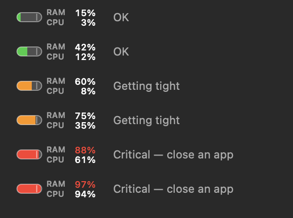

# Jauge RAM

[Français](README.md) · **English**

A gauge in the macOS menu bar that warns you **before** your Mac starts to slow down, and
lets you close the offending app in two clicks. Next to it, CPU usage. ("Jauge" is French
for "gauge".)

The app follows your Mac's language: French on a Mac set to French, English otherwise.



## Install with an AI

Copy this prompt (copy button at the top right of the block) and paste it into an AI
coding assistant that can run commands in your Mac's Terminal:

```text
Install Jauge RAM on this Mac from https://github.com/mehdi653/jauge-ram. Follow these
steps in order; if one fails, stop and explain the problem to me.

1. Check that this is an Apple Silicon Mac (`uname -m` prints arm64) running macOS 13
   or later (`sw_vers -productVersion`).
2. Check that the Swift compiler responds (`swiftc --version`). If not, run
   `xcode-select --install`, ask me to finish installing the Command Line Tools in the
   window that opens, wait for my confirmation, then continue.
3. If ~/jauge-ram does not exist, clone the repository into it. If it exists, check
   that `git -C ~/jauge-ram remote get-url origin` points to this repository and that
   `git -C ~/jauge-ram status --porcelain` prints nothing, then update it with
   `git -C ~/jauge-ram pull --ff-only`. Otherwise, ask me what to do.
4. Read ~/jauge-ram/build.sh and summarize in one sentence what it does.
5. If Jauge RAM is already running (`pgrep -x JaugeRAM`), ask me to quit it (gauge
   menu → "Quit Jauge RAM") and wait for my confirmation.
6. Build: `cd ~/jauge-ram && ./build.sh`.
7. Launch the app: `open ~/jauge-ram/build/"Jauge RAM.app"`, then check that it is
   running (`pgrep -x JaugeRAM`). If macOS refuses to open it, tell me to go to
   System Settings → Privacy & Security → "Open Anyway".
8. Ask me whether I see a "RAM / CPU" gauge in the menu bar. If not, the menu bar is
   often too full (notch): removing another icon brings it back. Remind me that
   "Launch at Login" can be checked in the gauge's menu.

Never use sudo. Apart from the Command Line Tools if they are missing, do not install
or change anything outside ~/jauge-ram; once launched, the app manages its own files.
```

Without an AI, the same steps by hand: see [Build](#build) and [Launch](#launch).

## Why not "RAM used"?

macOS deliberately keeps RAM full: free memory is wasted memory, so it uses it as a disk
cache. A "RAM used / total RAM" indicator therefore sits at ~95% all the time and tells
you nothing.

This gauge computes a composite score from three signals (see `Sources/MemoryStats.swift`):

| Signal | What it measures |
|---|---|
| `(wired + compressed) / total` | The share of RAM the system **cannot** free |
| swap written to the SSD, relative to RAM | The machine is already writing to disk to cope — this is what makes it slow |
| `kern.memorystatus_vm_pressure_level` | The level reported by the kernel; it sets a floor and has the last word |

Reading the gauge:

- **green, below 60%** — all good
- **orange, 60 to 80%** — getting tight, swap is filling up
- **red, above 80%** — close an app; a notification is sent (at most one every 10 min)

The small tick on the gauge marks the 80% threshold.

## CPU

To the right of the gauge, two stacked lines: `RAM 80%` then `CPU 12%`, the share of the
whole machine used over the last 3 seconds (100% = every core busy). See
`Sources/CPUStats.swift`.

Stacked to stay narrow (95 pt): on a Mac with a notch, macOS silently hides any menu bar
icon that no longer fits to the right of the notch. On a single line, the gauge was
144 pt wide and disappeared.

This is a different scale from Activity Monitor, where 100% means **one** core: a process
shown there at 150% appears here at 12.5% on a 12-core machine. This choice lets the list
in the menu add up to the displayed total.

The CPU never triggers a notification: 100% during a build is normal, and unlike full
RAM it does not freeze the machine.

## The menu

A click opens the details: app memory, compressed, wired (reserved by the system), file
cache (reclaimable, so harmless), swap, disk space and CPU.

Below that, **the biggest memory users**, grouped by process tree — Chrome's 40+ helpers
count towards Chrome, as in Activity Monitor. Processes without a Dock icon are included;
they are often the real culprits (a dev server, a VM).

Each line opens a submenu:

- **Switch to App** — to save your work before closing it
- **Quit** — a polite request; the app may offer to save
- **Force Quit / Stop Process** — with confirmation; unsaved work
  is lost

Components shipped with macOS are shown but never offered for stopping: they restart on
their own and killing them frees nothing.

Then **the biggest CPU users** (5 at most, above 1% of the machine), grouped the same
way and with the same submenus. The last line, *Other processes and system*,
estimates what the list is missing to reach the total: processes
beyond the five shown, small ones, and above all root processes the app cannot read (see
the limitations). It is an estimate (`≈`): the total and the processes are not sampled at
exactly the same instant.

## Build

```bash
./build.sh
```

No Xcode, no dependencies: only `swiftc` from the Command Line Tools. Produces
`build/Jauge RAM.app`, signed locally (ad-hoc). Apple Silicon (arm64) Macs only,
macOS 13 or later.

Translations: the English text lives in `Resources/en.lproj/Localizable.strings`, keyed by
the French text written in the code (`tr("…")`, see `Sources/Localization.swift`).
`fr.lproj` is deliberately empty: its presence is enough for macOS to pick French.

After each rebuild, quit the gauge (menu → *Quit Jauge RAM*) and relaunch it:

```bash
open "build/Jauge RAM.app"
```

## Launch

Double-click `build/Jauge RAM.app`. No Dock icon: everything lives in the menu bar.
*Launch at Login* in the menu installs a LaunchAgent
(`~/Library/LaunchAgents/com.mehdi.jaugeram.plist`).

The LaunchAgent runs `open -g` on the app, not its executable. On macOS 15, an ad-hoc
signed binary launched directly by launchd is killed at startup as soon as a rebuild has
changed its signature (`launchctl print gui/$(id -u)/com.mehdi.jaugeram` shows
`last exit reason = OS_REASON_CODESIGNING`, and the crash report "Launch Constraint
Violation"). Launched through LaunchServices, the app starts every time. A LaunchAgent
installed by an earlier version is rewritten by the app when it launches. launchd keeps
the old definition in memory until the next login, though: until then,
`launchctl kickstart` would still launch the executable directly. To apply it right away:

```bash
launchctl bootout gui/$(id -u)/com.mehdi.jaugeram
launchctl bootstrap gui/$(id -u) ~/Library/LaunchAgents/com.mehdi.jaugeram.plist
```

Once applied, `launchctl kickstart` relaunches `open`, not the gauge that is already
running. In System Settings (Login Items), the item may show up under the name `open`.

## Diagnostic modes

```bash
"build/Jauge RAM.app/Contents/MacOS/JaugeRAM" --dump         # measurements as text (CPU over 1 s)
"build/Jauge RAM.app/Contents/MacOS/JaugeRAM" --self-test    # builds the menu and prints it
"build/Jauge RAM.app/Contents/MacOS/JaugeRAM" --preview x.png # renders the gauge at every level
"build/Jauge RAM.app/Contents/MacOS/JaugeRAM" --test-alert   # triggers a notification
"build/Jauge RAM.app/Contents/MacOS/JaugeRAM" --disk         # caches and sizes, deletes nothing
```

## Disk cleanup

Swap lives on the disk. An APFS SSD degrades beyond 90% usage, and beyond 95% swap has
no room left: the machine stalls exactly as if RAM were full. The gauge therefore shows
free space in its menu and warns you (at most once every 30 min) below 10 GB.

*Clean Caches…* opens a window listing **known, hard-coded** paths
— no folder is discovered automatically, nothing outside this list is ever deleted.

Three categories:

- **dev** — checked by default. Tool caches (Gradle, uv, npm, bun, Cargo, Hugging Face,
  Puppeteer, DerivedData). Fully rebuilt when needed, but everything has to be
  downloaded again: the next build is slower, and Hugging Face models can weigh several
  GB and be unavailable offline. Uncheck what you want to keep.
- **system** — unchecked. `~/Library/Caches`, simulator caches. Safe, but an
  open app may complain: close your apps first.
- **DATA** — never deletable from the window, shown for information only
  (Parallels virtual machines, Downloads). These are your files.

The folders' contents are emptied and the folder itself is kept — some tools do not
recreate it. Deletion is permanent, without going through the Trash, after a
confirmation that lists every item and its size. A cache folder that is a symbolic link
(or has a parent that is one) is never emptied: it would be emptied at the link's target.

To see what can be reclaimed without deleting anything:

```bash
"build/Jauge RAM.app/Contents/MacOS/JaugeRAM" --disk
```

Note: Docker is not in the list: its image cache lives in a VM that `docker system prune`
handles much better than we could.

## Known limitations

- About 240 system processes owned by `root` cannot be measured without root
  privileges; they are missing from the *Background and system* total.
- For the CPU it is more visible: Spotlight (`mds_stores`), `WindowServer` and
  `kernel_task` are often the busiest, and never appear in the list. The total includes
  them; they fall into *Other processes and system*.
- If the menu bar is very crowded, the gauge can still slip behind the notch and
  disappear, and the app cannot reliably detect it. Removing another icon (⌘-drag it out
  of the bar) brings it back.
- A process that starts and exits between two samples (3 s) does not appear in the list;
  it only counts in the total.
- Per-process footprints do not add up exactly to the memory used: shared memory is
  counted several times. Activity Monitor has the same bias.
- Processes launched directly by `launchd` (Safari tabs, for example) are not attached to
  their app and show up separately.

## License

MIT — see [LICENSE](LICENSE).
