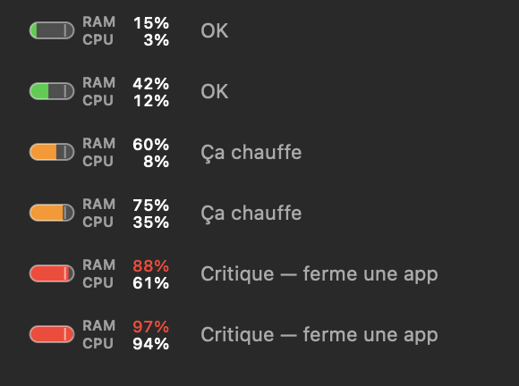

# Jauge RAM

**Français** · [English](README.en.md)

Une jauge dans la barre des menus qui prévient **avant** que le Mac ne rame, et permet
de fermer l'application fautive en deux clics. À côté, l'utilisation du processeur.

L'app suit la langue du Mac : en français sur un Mac en français, en anglais sinon.



## Installer avec une IA

Copie ce prompt (bouton de copie en haut à droite du bloc) et colle-le dans un assistant
de code IA capable de lancer des commandes dans le Terminal de ton Mac :

```text
Installe Jauge RAM sur ce Mac depuis https://github.com/mehdi653/jauge-ram. Suis ces
étapes dans l'ordre ; si l'une échoue, arrête-toi et explique-moi le problème.

1. Vérifie que c'est un Mac Apple Silicon (`uname -m` affiche arm64) sous macOS 13 ou
   plus récent (`sw_vers -productVersion`).
2. Vérifie que le compilateur Swift répond (`swiftc --version`). Sinon, lance
   `xcode-select --install`, demande-moi de terminer l'installation des Command Line
   Tools dans la fenêtre qui s'ouvre, attends ma confirmation, puis reprends.
3. Si ~/jauge-ram n'existe pas, clone le dépôt dedans. S'il existe, vérifie que
   `git -C ~/jauge-ram remote get-url origin` désigne ce dépôt et que
   `git -C ~/jauge-ram status --porcelain` n'affiche rien, puis mets-le à jour avec
   `git -C ~/jauge-ram pull --ff-only`. Sinon, demande-moi quoi faire.
4. Lis ~/jauge-ram/build.sh et résume-moi en une phrase ce qu'il fait.
5. Si une Jauge RAM tourne déjà (`pgrep -x JaugeRAM`), demande-moi de la quitter
   (menu de la jauge → Quitter Jauge RAM) et attends ma confirmation.
6. Compile : `cd ~/jauge-ram && ./build.sh`.
7. Lance l'app : `open ~/jauge-ram/build/"Jauge RAM.app"`, puis vérifie qu'elle tourne
   (`pgrep -x JaugeRAM`). Si macOS refuse de l'ouvrir, dis-moi d'aller dans Réglages
   Système → Confidentialité et sécurité → « Ouvrir quand même ».
8. Demande-moi si je vois une jauge « RAM / CPU » dans la barre des menus. Sinon, la
   barre est souvent trop pleine (encoche) : retirer une autre icône la fait revenir.
   Rappelle-moi que « Lancer au démarrage » se coche dans le menu de la jauge.

N'utilise jamais sudo. À part les Command Line Tools si elles manquent, n'installe et ne
modifie rien en dehors de ~/jauge-ram ; une fois lancée, l'app gère ses propres fichiers.
```

Sans IA, les mêmes étapes à la main : voir [Construire](#construire) et [Lancer](#lancer).

## Pourquoi pas « RAM utilisée » ?

macOS garde volontairement la RAM pleine : la mémoire libre est du gaspillage, il l'utilise
comme cache disque. Un indicateur « RAM utilisée / RAM totale » affiche donc ~95 % en
permanence et n'annonce rien du tout.

Cette jauge calcule un score composite à partir de trois signaux (voir `Sources/MemoryStats.swift`) :

| Signal | Ce qu'il mesure |
|---|---|
| `(wired + compressée) / total` | La part de RAM que le système **ne peut pas** libérer |
| swap écrit sur le SSD, rapporté à la RAM | La machine écrit déjà sur disque pour compenser — c'est ce qui fait ramer |
| `kern.memorystatus_vm_pressure_level` | Le niveau annoncé par le noyau ; il impose un plancher et a le dernier mot |

Lecture de la jauge :

- **vert, moins de 60 %** — tout va bien
- **orange, 60 à 80 %** — ça chauffe, le swap se remplit
- **rouge, plus de 80 %** — ferme une app ; une notification est envoyée (au plus une toutes les 10 min)

Le petit trait sur la jauge marque le seuil des 80 %.

## Le processeur

À droite de la jauge, deux lignes empilées : `RAM 80%` puis `CPU 12%`, la part de la
machine entière utilisée pendant les 3 dernières secondes (100 % = tous les cœurs
occupés). Voir `Sources/CPUStats.swift`.

Empilées pour rester étroites (95 pt) : sur un Mac à encoche, macOS masque sans prévenir
toute icône de la barre des menus qui ne tient plus à droite de l'encoche. Sur une seule
ligne, la jauge faisait 144 pt et disparaissait.

C'est une autre échelle que le Moniteur d'activité, où 100 % vaut **un** cœur : un
processus à 150 % y apparaît ici à 12,5 % sur une machine de 12 cœurs. Ce choix permet
à la liste du menu de s'additionner au total affiché.

Le processeur ne déclenche aucune notification : 100 % pendant un build est normal, et
contrairement à une RAM saturée cela ne fige pas la machine.

## Le menu

Un clic ouvre le détail : mémoire des apps, compressée, réservée au système, cache
fichiers (récupérable, donc sans gravité), swap, espace disque et processeur.

En dessous, **les plus gourmands en mémoire**, agrégés par arbre de processus — les 40+ helpers de
Chrome comptent avec Chrome, comme dans le Moniteur d'activité. Sont inclus les processus
qui n'ont pas d'icône dans le Dock, souvent les vrais coupables (un serveur de dev, une VM).

Chaque ligne ouvre un sous-menu :

- **Passer à l'app** — pour aller enregistrer avant de fermer
- **Quitter** — demande polie, l'app peut proposer d'enregistrer
- **Forcer à quitter / Arrêter** — avec confirmation ; le travail non enregistré est perdu

Les composants livrés avec macOS sont affichés mais jamais proposés à l'arrêt : ils
redémarrent seuls et les tuer ne libère rien.

Puis **les plus gourmands en processeur** (5 au plus, au-delà de 1 % de la machine),
regroupés de la même façon et avec les mêmes sous-menus. La dernière ligne, *Autres
processus et système*, estime ce qui manque à la liste pour atteindre le total : les
processus au-delà des cinq affichés, les petits, et surtout ceux de root que l'app ne
peut pas lire (voir les limites). C'est une estimation (`≈`) : le total et les
processus ne sont pas relevés au même instant.

## Construire

```bash
./build.sh
```

Ni Xcode ni dépendance : uniquement `swiftc` des Command Line Tools. Produit
`build/Jauge RAM.app`, signée localement (ad-hoc). Mac Apple Silicon (arm64) uniquement,
macOS 13 ou plus récent.

Traductions : les textes anglais sont dans `Resources/en.lproj/Localizable.strings`, avec
pour clé le texte français écrit dans le code (`tr("…")`, voir `Sources/Localization.swift`).
`fr.lproj` reste vide exprès : sa présence suffit pour que macOS retienne le français.

Après chaque reconstruction, quitte la jauge (menu → *Quitter Jauge RAM*) puis relance-la :

```bash
open "build/Jauge RAM.app"
```

## Lancer

Double-clic sur `build/Jauge RAM.app`. Aucune icône dans le Dock : tout est dans la barre
des menus. « Lancer au démarrage » dans le menu installe un LaunchAgent
(`~/Library/LaunchAgents/com.mehdi.jaugeram.plist`).

Le LaunchAgent exécute `open -g` sur l'app, et non son exécutable. Sous macOS 15, un
binaire signé ad-hoc lancé directement par launchd est tué au démarrage dès qu'une
recompilation a changé sa signature (`launchctl print gui/$(id -u)/com.mehdi.jaugeram`
affiche `last exit reason = OS_REASON_CODESIGNING`, le rapport de plantage « Launch
Constraint Violation »). Passée par LaunchServices, l'app démarre à chaque fois. Un
LaunchAgent installé par une version précédente est réécrit par l'app à son lancement.
launchd garde toutefois l'ancienne définition en mémoire jusqu'à la session suivante :
d'ici là, `launchctl kickstart` relancerait encore l'exécutable direct. Pour l'appliquer
tout de suite :

```bash
launchctl bootout gui/$(id -u)/com.mehdi.jaugeram
launchctl bootstrap gui/$(id -u) ~/Library/LaunchAgents/com.mehdi.jaugeram.plist
```

Une fois appliquée, `launchctl kickstart` relance `open`, et non la jauge déjà ouverte.
Dans les Réglages (Éléments d'ouverture), l'élément peut apparaître sous le nom de `open`.

## Modes diagnostic

```bash
"build/Jauge RAM.app/Contents/MacOS/JaugeRAM" --dump         # mesures en texte (CPU sur 1 s)
"build/Jauge RAM.app/Contents/MacOS/JaugeRAM" --self-test    # construit le menu et l'imprime
"build/Jauge RAM.app/Contents/MacOS/JaugeRAM" --preview x.png # rend la jauge à tous les niveaux
"build/Jauge RAM.app/Contents/MacOS/JaugeRAM" --test-alert   # déclenche une notification
"build/Jauge RAM.app/Contents/MacOS/JaugeRAM" --disk         # caches et tailles, sans rien supprimer
```

## Nettoyage du disque

Le swap vit sur le disque. Un SSD APFS au-delà de 90 % d'occupation se dégrade, et
au-delà de 95 % le swap n'a plus de marge : la machine bloque exactement comme si la RAM
était pleine. La jauge affiche donc l'espace libre dans son menu et prévient (au plus une
fois toutes les 30 min) sous 10 Go.

*Nettoyer les caches…* ouvre une fenêtre listant des chemins **connus et écrits en dur** —
aucun dossier n'est découvert automatiquement, rien n'est supprimé hors de cette liste.

Trois catégories :

- **dev** — coché d'avance. Caches d'outils (Gradle, uv, npm, bun, Cargo, Hugging Face,
  Puppeteer, DerivedData). Entièrement reconstruits au besoin, mais il faut alors tout
  retélécharger : le prochain build est plus lent, et les modèles Hugging Face peuvent
  peser plusieurs Go et manquer hors ligne. Décoche ce que tu veux garder.
- **système** — décoché. `~/Library/Caches`, caches des simulateurs. Sûrs, mais une app
  ouverte peut broncher : ferme-les avant.
- **DONNÉES** — jamais supprimable depuis la fenêtre, affiché pour information seulement
  (machines virtuelles Parallels, Téléchargements). Ce sont tes fichiers.

Le contenu des dossiers est vidé, le dossier lui-même conservé — certains outils ne le
recréent pas. La suppression est définitive, sans passage par la corbeille, après une
confirmation qui liste chaque poste et sa taille. Un dossier de cache qui est un lien
symbolique (ou dont un parent l'est) n'est jamais vidé : il le serait à l'endroit visé.

Pour voir ce qui est récupérable sans rien supprimer :

```bash
"build/Jauge RAM.app/Contents/MacOS/JaugeRAM" --disk
```

Note : Docker n'est pas dans la liste : son cache d'images vit dans une VM que
`docker system prune` gère bien mieux que nous.

## Limites connues

- Environ 240 processus système appartenant à `root` ne sont pas mesurables sans privilège
  root ; ils manquent au total « arrière-plan et système ».
- Pour le processeur, c'est plus visible : Spotlight (`mds_stores`), `WindowServer` et
  `kernel_task` sont souvent les plus actifs, et ne figurent jamais dans la liste. Le
  total, lui, les inclut ; ils tombent dans *Autres processus et système*.
- Si la barre des menus est très chargée, la jauge peut encore passer derrière l'encoche
  et disparaître, sans que l'app puisse le détecter de façon fiable. Retirer une autre
  icône (⌘-glisser hors de la barre) la fait revenir.
- Un processus né et mort entre deux relevés (3 s) n'apparaît pas dans la liste ; il
  compte seulement dans le total.
- Les empreintes par processus ne s'additionnent pas exactement à la mémoire utilisée :
  la mémoire partagée est comptée plusieurs fois. Le Moniteur d'activité a le même biais.
- Les processus lancés directement par `launchd` (les onglets de Safari, par exemple) ne
  sont pas rattachés à leur app et apparaissent séparément.

## Licence

MIT — voir [LICENSE](LICENSE).
